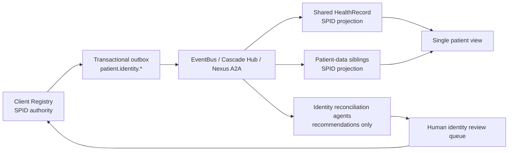

# Symphonix Patient Identity Closed Loop

## Decision

Symphonix Health should standardise every patient-data repo on one canonical internal identifier: the Symphonix Patient Identifier (SPID).

SPID uses the UK NHS number shape because the 10-digit modulus-11 format is familiar, compact, and self-checking. SPID is not an NHS Number. It must use the Symphonix-owned FHIR identifier system:

```text
https://fhir.symphonix.health/Id/patient
```

The NHS Number FHIR system remains an external alias only:

```text
https://fhir.nhs.uk/Id/nhs-number
```

## Current Architecture Findings

The repo review found that patient identity is fragmented:

| Area | Current pattern | Risk |
| --- | --- | --- |
| BulletTrain Client Registry | `mpiId` UUID primary key, `nationalID`, sample `NHS-*`, local duplicate/confusion tables | Registry exists but the clinical identifier is not the shared canonical patient id |
| BulletTrain Shared HealthRecord | Local `patient_id`, generated `PAT-*`, optional `national_id`, FHIR `Patient/{id}` | SHR can create patients outside the registry and drift from MPI |
| Common validation | `validate_patient_id` accepts UUID/CR/MPI; separate `validate_nhs_number` implements modulus-11 | Desired identifier shape exists, but naming and accepted formats are inconsistent |
| Appointment, portal, triage, maternity, screening, EPS siblings | `PAT-*`, `patient_id`, `nhs_number`, `patient_nhs_number`, docs saying NHS Number is primary | Cross-service patient view cannot be guaranteed |
| Bridge SDK | `CanonicalEnvelope` carries FHIR resources and PHI metadata but no explicit patient identity metadata | Adapters and agents must parse resources or payload-specific fields |
| Agent/control plane repos | Nexus A2A, global registry, health agent workspace are coordination surfaces | Useful for propagation and reconciliation, not a deterministic identity authority |

HMIS documentation says it should not hold patient identifiers, but shared schemas include patient fields. Treat HMIS as aggregate-only unless a product decision puts it in the patient-data loop.

## Local Repository Coverage

Local inventory was checked under `C:\Users\hgeec\github` on 2026-05-14. The patient identity static gate now includes only unique local Git repos whose origin is owned by `github.com/symphonix-health`. Other-owner local repos are excluded, even if their names mention Symphonix.

The static sibling scan covers these Symphonix Health repos:

* `ambulance-ems`
* `analytics-bi`
* `appointment-system`
* `blood-transfusion`
* `BulletTrain`
* `caid-agent`
* `cancer-pathway-tracker`
* `citizen-portal`
* `clinical-pathways`
* `community-nursing`
* `csaa`
* `design-system`
* `epaccs`
* `eps`
* `erp`
* `etps`
* `genomics-interpretation`
* `global-agent-registry`
* `gp-system`
* `health-agent-workspace`
* `healthcare-pain-points-plan`
* `HMIS`
* `insurance-eclaims`
* `kenya-uhc-implementation`
* `lis`
* `maternity-system`
* `mha-administration`
* `mortuary-and-me`
* `nexus-a2a-protocol`
* `pacs-ris`
* `pharmacy-system`
* `picis-system`
* `prompt-engine`
* `provider-portal`
* `REA-Agent-mcp`
* `scheduling-gateway`
* `screening-recall`
* `signalbox-mcp`
* `supply-chain-erp`
* `symphonix-eps-ig`
* `symphonix-health.github.io`
* `symphonix-public`
* `tool-library`
* `triage-api`

`symphonix-bridge-sdk` is the harness repo and is covered by its direct patient identity tests rather than by the sibling static scan.

The following local repos are excluded from the Symphonix Health patient identity sibling scan:

* `.github` - origin owner is `GmailTedam`
* `africa-marketplace` - origin owner is `Tedam-Technologies-UK-Ltd`
* `BulletTrain-gap-2-signatures` - duplicate checkout of `github.com/symphonix-health/BulletTrain`
* `claw-code-parity` - origin owner is `GmailTedam`
* `elocute` - origin owner is `Tedam-Technologies-UK-Ltd`
* `Liquid4Allcookbook` - origin owner is `Liquid4All`
* `openclaw` - origin owner is `GmailTedam`
* `symphonix-health-docs` - origin owner is `GmailTedam`

## NHS/PDS Design Lessons

The NHS Personal Demographics Service (PDS) is the master demographic database for NHS patients and holds the NHS number as the national unique identifier. NHS England Digital states that PDS has a National Back Office for data quality and that duplicate records and confusion cases are resolved through that office.

NHS handling patterns to mirror:

| NHS pattern | Symphonix interpretation |
| --- | --- |
| Duplicate NHS Numbers: multiple identifiers for one patient are investigated, confirmed, and merged to leave one number | Confirmed duplicates become alias/merge events. Old identifiers are retained as aliases and never reissued |
| Confused record: one number used by multiple patients is investigated and corrected | SPID confusion must enter under-review state. Agents can recommend, but humans approve split, merge, or no-merge |
| Sensitive status / S-flagging: location/contact access is restricted and some services are unavailable | Model `restricted` lifecycle state. Suppress location/contact disclosure and automated outreach unless policy allows |
| Stop-noting: older language for restricting access/flagging a record | Implement this as the modern restricted/sensitive status, not a free-text note |
| Death status: NHS Notify blocks messages where PDS has formal or informal death status | Model formal and informal death states. Stop active care loops and notifications, but do not delete clinical records |
| Incorrect death status: NBO can investigate and reset death status | Add `patient.identity.reinstated` or `patient.identity.death_status_corrected` with full audit |
| Records management: patient records are retained after death according to health record retention policy | Death changes lifecycle and permitted workflows; it is not a deletion event |

Key sources used:

* NHS England Digital, Personal Demographics Service: https://digital.nhs.uk/services/personal-demographics-service
* NHS England Digital, National Back Office for PDS: https://digital.nhs.uk/services/personal-demographics-service/national-back-office-for-the-personal-demographics-service
* NHS England Digital, PDS data quality incidents: https://digital.nhs.uk/services/personal-demographics-service/national-back-office-for-the-personal-demographics-service/data-quality-incidents
* NHS England Digital, restricting access to a patient demographic record: https://digital.nhs.uk/services/personal-demographics-service/restricting-access-to-a-patients-demographic-record
* NHS England Digital, NHS number format: https://digital.nhs.uk/services/personal-demographics-service/nhs-number
* NHS Data Dictionary, NHS NUMBER modulus-11 format: https://v2.datadictionary.nhs.uk/data_dictionary/data_field_notes/n/nhs_number_de.asp%40shownav%3D0.html
* NHS Notify, recipients you cannot message: https://webcms.prod.nhsnotify.national.nhs.uk/using-nhs-notify/recipients-you-cannot-message
* NHS Records Management Code of Practice: https://transform.england.nhs.uk/information-governance/guidance/records-management-code/records-management-code-of-practice/

## Target Architecture



### Authority Boundaries

Client Registry owns:

* SPID allocation and validation.
* External aliases: NHS Number, MRN, legacy `mpiId`, local `PAT-*`, passport, national identifiers.
* Identity lifecycle state: `active`, `inactive`, `restricted`, `under_review`, `confused`, `merged`, `deceased`.
* Merge, link, split, restriction, death-status correction, and reinstatement workflows.
* A transactional outbox for identity lifecycle events.

Shared HealthRecord owns:

* Clinical records, documents, consents, and privacy constraints.
* A local patient projection keyed by SPID.
* Fail-closed write checks against the local projection or registry.

Patient-data siblings own:

* Local business objects such as appointments, prescriptions, specimens, pathways, imaging orders, and episodes.
* A local patient projection keyed by SPID.
* Domain identifiers that reference SPID, not replace it.

Agents own:

* Duplicate/confusion detection recommendations.
* Reconciliation triage.
* Migration assistance and evidence gathering.
* No autonomous identifier allocation, merge, split, restriction removal, or death-status mutation.

## Event Contract

All identity events must include:

```json
{
  "patient_id": "9000000009",
  "identifier_system": "https://fhir.symphonix.health/Id/patient",
  "identity_version": 1,
  "correlation_id": "corr-example",
  "idempotency_key": "idem-example",
  "lifecycle_status": "active",
  "occurred_at": "2026-05-13T00:00:00Z",
  "source": "client-registry"
}
```

Required event types:

* `patient.identity.created`
* `patient.identity.updated`
* `patient.identity.restricted`
* `patient.identity.confusion_detected`
* `patient.identity.linked`
* `patient.identity.merged`
* `patient.identity.deceased`
* `patient.identity.death_status_corrected`
* `patient.identity.reinstated`
* `patient.identity.reconciled`

## FHIR Binding

FHIR Patient resources should carry SPID as:

```json
{
  "resourceType": "Patient",
  "id": "9000000009",
  "identifier": [
    {
      "use": "official",
      "system": "https://fhir.symphonix.health/Id/patient",
      "value": "9000000009"
    }
  ]
}
```

Other FHIR resources should reference the patient as:

```json
{
  "subject": {
    "reference": "Patient/9000000009"
  }
}
```

If a real NHS Number is known, add it only as an external identifier:

```json
{
  "system": "https://fhir.nhs.uk/Id/nhs-number",
  "value": "9434765919"
}
```

## Requirements And Scenarios

Generated traceability assets live in:

* `tests/harness/patient_identity/requirements_matrix.json`
* `tests/harness/patient_identity/patient_identity_scenarios.json`

The matrix covers:

* Single issuing authority.
* NHS-style checksum shape without NHS namespace use.
* FHIR binding.
* Creation propagation.
* Subscriber projections.
* Fail-closed clinical write checks.
* Idempotent outbox and replay.
* Confused-record, merge/link, restriction, stop-note, death, and reinstatement lifecycle.
* Agent governance.
* Closed-loop reconciliation.
* Migration from `mpiId`, `nationalID`, `nhs_number`, and `PAT-*`.

## Implementation Plan

### Phase 1: Contract And Shared SDK

* Use `bridge_sdk.patient_identity` as the shared validation and FHIR helper module.
* Add SPID fields to `CanonicalEnvelope`: `patient_id`, `patient_identifier_system`, `patient_identity_version`, and `patient_lifecycle_status`.
* Publish JSON Schema or Pydantic models for all `patient.identity.*` events.
* Update adapters to extract SPID from FHIR `Patient`, `subject.reference`, and explicit `patient_id`.

### Phase 2: BulletTrain Registry And SHR Refactor

* Client Registry:
  * Add `patient_id` / SPID column and unique index.
  * Keep existing `mpiId` as technical row id or alias.
  * Rename `nationalID` semantics to external identifier, not master patient identity.
  * Add SPID generation with modulus-11 validation and collision checks.
  * Add lifecycle statuses and transactional outbox.
* Shared HealthRecord:
  * Remove local `PAT-*` generation for patient creation.
  * Accept patient creation only from Client Registry or a registry creation event.
  * Enforce SPID on FHIR Patient and subject references.
  * Block non-emergency writes for invalid, unknown, under-review, restricted, or deceased identities.

### Phase 3: Sibling Migration

* Replace internal `nhs_number`, `patient_nhs_number`, and `PAT-*` usage with SPID.
* Keep real NHS Number only as an optional external alias.
* Add patient projection consumers to appointment, provider portal, triage, maternity, screening, EPS, pharmacy, GP, LIS, PACS/RIS, epaccs, ambulance, cancer pathway, and mortuary repos where they handle patient data.
* Backfill aliases from legacy identifiers to SPID.

### Phase 4: Closed-Loop Governance

* Add reconciliation jobs comparing Client Registry and subscriber projections.
* Route drift and suspected confusion to agent-assisted review.
* Require human approval for merge, split, restriction removal, death-status correction, and reinstatement.
* Add dashboards and audit queries keyed by SPID and correlation id.

## Test Harness

Fast contract tests:

```powershell
python -m pytest tests/test_patient_identity.py tests/harness/patient_identity/test_patient_identity_contract.py -q
```

Static enforcement is always active:

```powershell
python -m pytest tests/harness/patient_identity/test_patient_identity_contract.py -q
```

The static scan checks owner-verified Symphonix Health sibling repos for legacy identity patterns that must be removed or explicitly quarantined before rollout:

* `nhs_number` / `patient_nhs_number` / `nhsNumber` as internal fields.
* `NHS Number as primary patient identifier` documentation.
* local `PAT-*` patient ids.
* local `PAT-` generators.
* `mpiId` as the clinical primary key.

Known sibling findings are tracked in `tests/harness/patient_identity/legacy_identity_quarantine.json`. The test fails on any new unquarantined finding and also fails when a quarantined entry no longer appears, so sibling migrations have to remove their resolved entries instead of leaving stale backlog.

## Architecture Rationale

The strongest architecture is deterministic identity authority plus agent-assisted reconciliation. Pure agentic identity management is too risky because identifier allocation, merging, restriction, and death-state changes are safety-critical and audit-heavy. Pure deterministic matching leaves real-world duplicate and confused-record cases unresolved without expensive manual discovery.

The right split is:

* Deterministic services own the contract, validation, state transitions, outbox, and idempotency.
* Agents find probable issues, gather evidence, explain recommendations, and open tasks.
* Humans approve high-risk identity lifecycle corrections.

This keeps Symphonix Health agent-first where agents add value, but prevents agents from becoming an unsafe master patient index.
